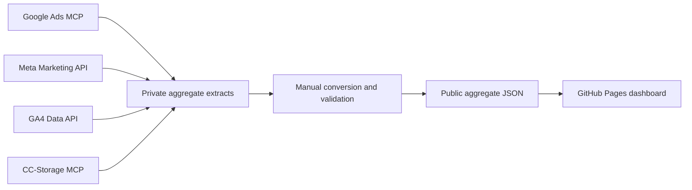

# Data, connections and operations

This guide describes the Phase 1 implementation accepted September 10, 2026, kept current for later data refreshes. The cutoff is now September 17, 2026 (it was September 9 at acceptance; moved 2026-09-18). For status and ownership context, read [Phase 1 completion](PHASE_1_COMPLETE.md) and [Claude handover](CLAUDE_HANDOVER.md). For the separate source-tracking audit (GTM/GA4/Meta fixes to `familyheirloomstorage.com`'s own tracking, not the dashboard) read [Tracking audit handover](TRACKING_AUDIT_HANDOVER.md).

## Connections and architecture



| Source | Phase 1 read method | Authentication | Public output |
| --- | --- | --- | --- |
| Google Ads | Google Ads MCP; bounded account, campaign, ad-group and geography reports | Authorized connector outside browser | `google-ads.json` and overlapping Overview totals |
| Meta Ads | Direct Meta Marketing/Graph API, version used v25.0; paginated insights | Protected existing system-user credential in private environment | `meta.json` and matching Overview totals |
| Google Analytics | Direct GA4 Data API; Analytics Admin API for stream verification | Authorized Google Application Default Credentials in private environment | `analytics.json` |
| CCStorage | CC-Storage MCP; read-only monthly operational aggregates | Authorized connector outside browser | Overview facility aggregates and separate private workbook |

The GA4 website stream is `G-TCSG6BY1KK`. Analytics Admin access was enabled on the existing reporting project to verify its identity; site tags, event definitions and tracking configuration were not changed. Private account/property identifiers, credential contents and raw query evidence belong in protected operational context, not these public documents.

The browser fetches four JSON snapshots. It has no source credentials or source API calls. Source connectivity verified during extraction does not mean live data in the dashboard or permanently valid authorization.

## Public dataset contracts

| File | Schema | Grain and content |
| --- | --- | --- |
| `data/reporting.json` | `storage-signal.reporting.v1` | Four periods; Google/Meta account aggregates; 39-facility CCStorage roster per period; timestamps and alternate reporting-view volume |
| `data/google-ads.json` | `storage-signal.ads-details.v1` | Monthly/YTD periods, independent account totals, campaign/ad-group/city rows, rates, geography coverage and reconciliation |
| `data/analytics.json` | `storage-signal.analytics.v1` | Monthly/direct-YTD summaries and dimensions, daily-coverage result, stream context and sampling/threshold/pagination notes |
| `data/meta.json` | `storage-signal.meta.v1` | Monthly hierarchy, ad-set-level dimension reports, adjacent seven-day windows and deterministic insight text |

Campaign/ad identifiers in existing public files identify reporting entities, not customers. Do not introduce visitor, lead or customer records, credentials or private source payloads during future refreshes. Current-snapshot sanitization does not establish that Git history has been purged; the private handover tracks historical-content review separately.

## Metric contracts

### CCStorage

| Metric | Definition | Interpretation rule |
| --- | --- | --- |
| Gross recorded payments | Original eligible amounts assigned to effective payment month | Register measure, not audited revenue or bank settlement |
| Refund adjustments | Current refunds assigned back to original payment month | Later refunds can revise earlier months |
| Net recorded payments | Eligible gross minus current refunds | Per-facility `gross - refunds = net` |
| Eligible payments | Complete, Manually Entered, Partially Refunded and Refunded payment count | Declined, Void and Pending Approval excluded |
| Move-ins / move-outs | Current non-void leases by respective event date | Lease events, not distinct customers; successful query with no event is zero |
| Occupied leases / units | Snapshot at month end, or at the reporting cutoff (currently September 17) for MTD | Missing historical snapshot is unavailable |
| Occupancy | Occupied leases divided by storage units | Unit-weighted over available snapshots; never average facility percentages |
| Autopay leases | Source count at occupancy snapshot | Not payment-method share or collection-success rate |

Every current-roster facility remains represented even when earlier payment/occupancy history is missing. Missing history is null, not zero. Counts exceeding capacity are flagged, not capped. Percentage comparisons are suppressed when facilities with data differ. September MTD (September 1–17) is not compared with a full prior month.

**Known same-day turnover double-count (source-level, unresolved).** Verified directly against CCStorage's `leases` and `occupancy_by_date_and_company` tables on 2026-09-12: a lease counts as occupying a given date under the rule `move_in_date <= date AND (move_out_date IS NULL OR move_out_date >= date) AND void IS FALSE` (confirmed by reproducing the published daily count exactly — 92 leases for company 1175 on 2026-09-09 — from raw lease rows under this exact boundary). The rule is inclusive on both ends: a tenant who moves out *on* a given date and a tenant who moves into the same unit *on* that same date are both counted as occupying it. If a unit is ever vacated and re-rented on the same calendar day, that single physical unit is counted twice in that day's occupied-leases total, inflating occupancy for that day. This is a property of CCStorage's own view definitions, not of this dashboard's build scripts, and it cannot be corrected downstream without unit-level lease data (not currently part of the extracted aggregates).

A full lease-level scan of June-September 2026 across all 39 facilities found **zero actual same-day turnovers** — the closest real cases have at least a 1-day vacancy gap — so no historical number shown on this dashboard is currently affected. The risk is latent: it would only distort a reported day's occupancy once a genuine same-day turnover occurs, and the effect would be small (one unit out of roughly 90-120 per facility).

The separate CCStorage reporting view is disclosed for the full portfolio even when a facility filter is active. It is not the dashboard payment basis:

| Period | Register net | Separate reporting-view volume |
| --- | ---: | ---: |
| June | $374,641.87 | $347,120.79 |
| July | $425,702.84 | $398,203.33 |
| August | $467,756.34 | $432,019.05 |
| September 1–17 | $369,503.90 | $347,212.47 |

Values are read from the public `data/reporting.json` (each period's `reportingViewVolume`, and register net as the sum of its facilities' `net`), as of the 2026-09-17 CCStorage re-extraction. They replace the September 10 acceptance values (for example June $374,747.87 and September 1–9 $324,306.85), which later extractions revised.

The cause of these differences remains unresolved. Do not substitute the series or describe either as bank reconciliation.

### Google Ads

- Source measures are cost in micros, impressions, clicks and reported conversions. Retain micros until display; dollars are `costMicros / 1,000,000`.
- CTR is clicks/impressions; CPC is spend/clicks; cost per conversion is spend/conversions. Undefined denominators produce null.
- Conversions can be fractional. Preserve precision. Campaign/ad-group and independent account delivery reconcile exactly; the validator requires conversion differences below 0.005. A permitted source difference can cross a displayed rounding boundary.
- Primary conversions are also split by conversion-action category. The split uses `metrics.conversions`, never `metrics.all_conversions`, and must reconcile to the unchanged Google-reported conversion total within 0.005:

  | Dashboard group | Google Ads conversion-action category | Meaning in this dashboard |
  | --- | --- | --- |
  | Leads & calls | `SUBMIT_LEAD_FORM`, `PHONE_CALL_LEAD` | Submitted lead forms and completed calls from ads |
  | Phone-number clicks | `CONTACT` | Click on a phone-number link, not a completed call |
  | Rent Now / Pay bill button clicks | `BEGIN_CHECKOUT` | GA4-imported button click, not a lead; the import has recorded from 2026-08-28 |
  | Store visits (modeled) | `STORE_VISIT` | Google-modeled store visits |
  | Rentals | `PURCHASE` | Completed rental action; currently zero in the verified source read |
  | Other | Any other category | Primary conversions not mapped above |

  Action names are display labels only; category determines the group. `Clicks to call` and `Local actions - *` can appear in `all_conversions` without being primary conversions and therefore do not enter this split. Old source extracts without the action reports remain buildable and omit split fields; use `--require-conversion-split` when a refresh must include them.
- Detail YTD sums additive monthly values and recomputes rates. Independent direct account YTD provides reconciliation evidence.
- Campaign-location labels come from campaign names, not a facility attribution join.
- Audience-city coverage is incomplete. Presence/interest are advertising geography categories, not necessarily renter addresses or facility locations.

### Google Analytics

- Summary measures: `totalUsers`, `newUsers`, `sessions`, `engagedSessions`, `screenPageViews`, `keyEvents`.
- Headline users are the direct summary for the exact selected range. Never sum monthly, daily, page, city or channel users to manufacture a distinct total.
- YTD summaries and dimension reports are queried directly. Engagement rate is engaged sessions/sessions; an undefined denominator produces null.
- Key events follow configured definitions; they are not independently verified enquiries, rentals or Google Ads conversions.
- Page paths with query strings, fragments, contact-like values, opaque identifiers or sensitive payment/invoice patterns are combined into `[Private paths omitted]`. Its views/engagement duration are additive; users are null because distinct users cannot be recovered by addition.
- Retain sampling, thresholding, grouped-away-row and pagination metadata. Reconcile page views when metadata permits exact reconciliation; do not hide caveats to force a match.
- No recorded activity before February 13 is an availability gap, not proof of zero traffic. First observation does not explain the gap or guarantee complete instrumentation afterward. Latest days can still process.

**Duplicate GA4 tracking tag, found and fixed 2026-09-12.** A live audit of `GTM-MPM54W98` (the site's GTM container) found a tag named "Google Ads Gtag" — a Google Tag type, firing on every page load sitewide — whose Tag ID field was misconfigured to a GA4 measurement ID (`G-J6PMFD5C5K`) instead of a Google Ads conversion ID (`AW-...`) as its name implies. This had been live for at least 7 months, silently sending a parallel copy of every pageview to an undocumented second GA4 property that this dashboard never reads from and that no one on the current team has account access to (it does not appear anywhere in this Google login, including GTM's cross-account Google-tags search — it was set up under a different, unknown Google account, most likely a prior developer or vendor). This is almost certainly the true cause of the February 13 gap noted above: traffic before the Stape server-side GA4 setup went live was very likely landing in this orphan property instead of `G-TCSG6BY1KK`. Because the orphan property is inaccessible, its historical data could not be recovered or reconciled. The misconfigured tag (and a smaller, harmless redundant tag also pointed at the correct property) were paused in the GTM workspace and the container was published; verified live on production immediately after — the site now sends exactly one `page_view` hit per load, to `G-TCSG6BY1KK` only.

**Duplicate Meta PageView, found and fixed 2026-09-12.** The same GTM audit found a second, unrelated duplication: a `Custom HTML` tag named "FB Pixel (Custom HTML)" contained Meta's generic hand-installed base pixel snippet (`fbq('init', ...); fbq('track', 'PageView');`, no `eventID`), firing on every page alongside the properly configured `[Stape] Meta - PageView` tag (which sends the same event server-side with a matching event ID for deduplication). Because the hand-installed copy carried no event ID, Meta could never deduplicate it against the server-side event, so every PageView was counted twice. Testing click-triggered events (`InitiateCheckout`, and by tag structure `Contact`/`Lead`) confirmed they each have only one tag with no independent client-side counterpart, so they were not affected — Meta's reported PageView volume was inflated, but lead/conversion counts (and the CPL figures derived from them) were not. The redundant tag was paused and the container republished; verified live on production that exactly one PageView fires per pageload.

**Broken `contact` tracking, found and fixed 2026-09-12.** The GTM trigger behind the `contact` event (feeding GA4, Meta, and the data-layer push, and imported by Google Ads as a conversion action) was hardcoded to a single phone number (`tel:828-817-9226`) out of dozens used across the 39-facility portfolio — verified by comparing phone numbers on two different facility pages. Fixing only the hardcoded value was not sufficient: the trigger's type (`Click - All Elements`) failed to resolve the clicked link's URL at all on this Framer-rendered site (`Click URL` returned an empty string in GTM's own debugger), because the click lands on a nested `<span>` and the generic click listener doesn't reliably walk up to the real `<a href>`. The fix changed both the match condition (to match any `tel:` link) and the trigger type, to `Click - Just Links` — mirroring the already-working `click - outbound_link` trigger in the same container. Verified in GTM's live debugger on two different facility phone numbers (the original hardcoded one and an unrelated one in a different area code) that all three `contact` tags fire correctly with no regression, then verified again live on production after publishing.

### Meta Ads

| Metric | Source value or calculation |
| --- | --- |
| Spend, impressions, reach, frequency, all clicks | Direct source summary fields |
| Link clicks | `inline_link_clicks` |
| Meta leads | Action `lead` only |
| Grouped Meta leads | `onsite_conversion.lead_grouped` |
| Website pixel leads | `offsite_conversion.fb_pixel_lead` |
| Conversations | `onsite_conversion.messaging_conversation_started_7d` |
| Landing-page views | `landing_page_view` |
| Engagement / reactions / comments / saves | Corresponding source action categories |
| Video plays | `video_view` in `video_play_actions`; unavailable when field absent |
| CPL / link CPC / CPM / link CTR | Spend/leads; spend/link clicks; spend/impressions × 1,000; link clicks/impressions |

Lead, grouped-lead, pixel-lead and conversation categories can overlap. Do not add them to create the headline lead count. Reach/frequency come from the exact selected account/campaign/ad-set/ad summary, never sums across rows/months.

Breakdowns are at ad-set grain with hierarchy context. Regional total leads, website leads, conversations and landing-page views were not returned and remain null; regional grouped Meta leads are available. A category never returned at a breakdown grain is unsupported, not evidence of zero outcomes. Recheck support before changing the contract.

## Scope and filter behavior

| View | Headline/monthly-chart scope | Table/export-only changes |
| --- | --- | --- |
| Overview | Brand/facility changes CCStorage; ads remain account-wide | Facility search and table coverage filter |
| Google Ads | Campaign-location, campaign, supported ad group; city/presence-interest in geography mode | Text search |
| GA4 | Direct whole-website selected-period summary; monthly metric choice | Channel/page/city table selection and text search |
| Meta | Exact account/campaign/ad-set/ad summary selected in hierarchy | Search and breakdown rows; insights remain account-wide |

Google ad-group filters are unavailable in the separate geography report. Meta dimensions clear/disable individual-ad selection because they are available at ad-set grain. This prevents unsupported headline/table combinations.

Charts show every loaded month within source scope, not just the selected period. The selected-period figure can show YTD; YTD is never another monthly column. Rates are recomputed from monthly scoped totals. Missing summaries/undefined rates show n/a. Partial September and February GA4 coverage are marked.

| Chart | Selectable metrics |
| --- | --- |
| Google Ads | Spend, clicks, impressions, conversions, CTR, average CPC, cost per conversion |
| GA4 | Users, sessions, views, engaged sessions, engagement rate, key events, new users |
| Meta | Spend, leads, CPL, link clicks, link CTR, reach, frequency, impressions, conversations |

CSV exports contain all matching table rows, not just the current page. Rates export as numeric fractions; text is guarded against spreadsheet formula injection. Search does not change source totals.

## Meta decision-note rules

`scripts/build-meta.py` creates notes deterministically:

1. Compare completed months for account CPL; decompose lead changes by ad set.
2. For partial September, compare adjacent seven-day windows instead of MTD against a full month.
3. Identify lowest CPL among ad sets with at least 10 leads, with lead-quality/capacity checks before budget testing.
4. Investigate an ad set with at least 5 leads and CPL over 25% above account average.
5. Identify concentration when an ad with at least 10 leads supplies at least 35% of account leads.
6. Screen possible fatigue only when both seven-day windows have at least 5 leads, 30 link clicks and 1,000 impressions, with frequency up at least 20%, link CTR down at least 15% and CPL up at least 20% together.

These are operational filters, not significance or causation tests. Notes retain observation, proposed action, confidence wording and evidence basis. No note triggers an advertising mutation.

## Manual refresh runbook

This procedure requires authorized source access and private extraction context beyond this repository.

1. **Choose cutoff and scope.** Define included dates in source reporting time zones. Record timestamps and account/stream verification privately. Keep incomplete months labeled and overlapping source dates aligned.
2. **Extract Google Ads.** Retrieve elapsed 2026 months plus independent direct account YTD; campaign/ad-group, city and geographic-label reports; account- and campaign-level primary conversions by action; and conversion-action definitions. Verify reports did not reach the cap; partition bounded requests if needed. Keep query/response evidence private.
3. **Extract GA4.** Apply the verified stream filter to monthly and direct-YTD summary/channel/page/city reports, plus a YTD daily-coverage report. Complete pagination with continuous offsets and retain metadata.
4. **Extract Meta.** Retrieve monthly account/campaign/ad-set/ad and four dimension reports, plus adjacent seven-day ad-set windows for each month. Complete pagination and retain unsupported-category/date evidence.
5. **Extract CCStorage.** Read roster, eligible payments, lease events and period-end occupancy via CC-Storage MCP. Keep every roster facility, null history and alternate reporting-view totals.
6. **Build details.** Use the offline converters below with private source inputs. They make no network calls.
7. **Synchronize Overview.** Meta's converter updates matching Meta Overview fields. Google/GA4 converters do not update Overview; synchronize overlapping Google account values separately. Update CCStorage aggregates, dates and refresh metadata with the private Overview preparation workflow. There is no public all-source Overview builder.
8. **Review and validate.** Run the validator, check public-data suitability, review source/date reconciliation and relevant browser behavior. Failed extraction must not become zero data.
9. **Publish the reviewed scope.** Follow applicable owner authorization for the actual public payload, then verify the deployed revision and behavior using [the release guide](VALIDATION_AND_RELEASE.md).

```text
python scripts/build-google-ads.py PRIVATE_GOOGLE_ADS_SOURCE.json --require-conversion-split
python scripts/build-analytics.py PRIVATE_GA4_SOURCE.json
python scripts/build-meta.py PRIVATE_META_SOURCE.json
python scripts/validate-data.py
```

The uppercase filenames are placeholders. Supply quoted real paths from the protected operational workspace. Do not copy private extracts into this public repository to run the scripts.

Google/GA4 converters are scoped to 2026. The Meta converter and several Overview labels are currently scoped to June–September 1–17, 2026 (the current cutoff; labels derive it from `data/reporting.json`). Extending dates requires reviewing hard-coded periods, weekly evidence and labels; it is not just a different file argument. The validator retains the current regional unsupported-metric contract. Resolve these limits before scheduled refreshes.

## Questions tab data (added 2026-10-29)

The Questions tab (`questions.js`) computes its answers in the browser from the existing snapshots plus three files:

- `data/restatements.json` (public aggregate): `scripts/build-restatements.py git:HEAD` compares the new `reporting.json` with the last committed one and lists every revised value in past months, portfolio and facility level. A month whose end date only moved forward is "extended", not restated. The refresh script runs it after `build-meta.py`; a rerun with no new extraction leaves the file unchanged.
- `data/restricted/tracking.json` (private): `scripts/build-tracking.py` turns the GA4 BigQuery events, Google Ads daily rows, Meta lead records and the `/*fhs:sources*/` extraction into daily signal counts (America/New_York dates) and a monthly visitor-to-rental funnel. A day is flagged only when a signal that normally runs at least 10 a day falls below 25% of its 14-day median; days after the last GA4 export are "not exported yet", never zero. `portalAdSource` adds `liveFrom: "2026-10-29"` (iframe source forwarding went live), a computed pre-launch portal-event/click-ID baseline, daily `portalSessions` / `rentalCompletedEvents` totals and `portalSessionsWithAdClick` / `rentalCompletedEventsWithAdClick` counts through the cutoff (unexported days are null), and `rentalsBySource` grouped by `clickId` (`gclid`, `fbclid` or `gclid+fbclid`) plus verbatim sanitized source/medium/campaign, with `rentalEvents` per row. Sessions use the `(user_pseudo_id, ga_session_id)` pair and count on the first portal event's Eastern date; rental events count on their own date, on any host. An ad click requires `has_gclid` or `has_fbclid` on at least one event in the session; UTM/manual source values alone never qualify. Organic search, referrals, ChatGPT and CCStorage's own links are not counted as ads. A click ID shows the session began with an ad click, not that the ad caused the rental. Breakdown labels prefer session `utm_source` / `utm_medium` / `utm_campaign` values; each field falls back to `manual_*` only when it has no usable UTM value. Ignore source `ccstorage` and medium `link` (case-insensitive, surrounding whitespace ignored) before choosing labels. A missing or conflicting label in the preferred field stays null; conflicting UTM values never fall back to manual values. First-user source is not reused and click IDs never invent source labels. Sessions with any `utm_campaign`, `manual_campaign` or `first_campaign` starting `owner_test` are excluded from all GA4 counts (including heartbeat/funnel/baseline) and counted once in `portalAdSource.testSessionsExcluded` across the export; tagged events missing session keys are excluded but cannot count as sessions. Coverage still includes test-only exported days. The CMO answer is **Platform-reported (GA4)**, covers all days since go-live regardless of the month selection, and stays separate from Confirmed / Credited / Not recorded and CCStorage move-in counts. Output contains aggregates and source labels only, no visitor/session identifiers, event timestamps or pages. Run against the 2026-08-13 to 2026-10-28 history before this addition, the heartbeat flagged the 2026-09-29 to 2026-10-06 GA4 outage.
- `data/restricted/budgets.json` (private, owner-entered): monthly ad budgets per platform, `{"months": {"2026-11": {"google": 6000, "meta": 600}}}`. Empty until the owner fills it; the budget question stays "not answerable yet" until then.

Blended cost per move-in (all spend ÷ all move-ins) is deliberately not shown; cost per renter waits for Confirmed or Credited evidence under the 2026-10-27 tiers.

### Watch list and Keywords tabs (private host only, 2026-10-30)

- `data/restricted/ads-watch.json`: `private-scripts/fetch-google-ads-watch.ps1` pulls the last 90 days (ending at the last complete America/New_York day) of daily campaign rows (spend, impressions, clicks, ad calls, impression-share counts), daily keyword rows, conversions by category for both, current keyword Quality Score and its three parts, and Google's own impression share for the 7/14/30/90-day windows; `scripts/build-ads-watch.py` writes the file. `refresh-dashboard.ps1` runs both with the other restricted builders. A lead is `leads_and_calls` + `phone_clicks`, the same grouping as `build-google-ads.py`; checkout-button clicks and store visits are shown apart and never counted as leads. Preset windows show Google's impression share; custom ranges and totals rebuild it from counts and are marked "≈".
- Watch lists are shared by everyone who signs in to the private host. `watchlists-api.php` (reached only through `gate.php` at `GET`/`POST /api/watchlists`) keeps them in `.watchlists/watchlists.json`, never served, with the previous version beside it. A save needs the signed-in session, the page's CSRF token (the `fhs-csrf` meta tag `gate.php` adds to `index.html`) and the version the page loaded; a stale page gets 409 and the latest lists. Until anything is saved, the API returns the "Meeting 30 Oct" list (Augusta, Augusta RV/Boat/Car, Statesboro Stockyard Rd, Crawford). On a local preview there is no API, so lists are kept in the browser and the tab says so.

## Restricted Tenants tab and the 2026-09-17 CCStorage re-extraction

*Dated record.* The paragraphs below describe the 2026-09-17 and 2026-09-18 refresh work as it happened, when the shared cutoff was September 9. The cutoff was moved to September 17 on 2026-09-18; the current public datasets and the Tenants source share that cutoff.

Full detail, including the extraction method and every verification, is in
[the Tenants plan](RENTER_LISTS_PLAN.md). The contract points that affect numbers:

**CCStorage figures were re-extracted on 2026-09-17** (`ccExtractedAt`
`2026-09-17T16:50:55.562+00:00`), cutoff still September 9 at that date so Google and Meta were unchanged.
Sources revise history, and this refresh shows it: June net payments fell $106.00 and July
$209.08 (ACH payments later returned), August move-ins fell 135 to 134 (a lease voided after
the previous pull), and September 1–9 net rose $9,787.29 as payments posted after the earlier
snapshot. Treat each pull as a dated snapshot, not a correction of an error.

**The refresh was broken from 2026-09-11 to 2026-09-18 and is now working.** Meta had been
pulled through September 11 while Google stopped at September 9, so `build-reporting.py` (which
asserts one Google daily row per elapsed day) and `build-meta.py` (whose September campaign
spend did not sum to the account total in that mid-day snapshot) both failed. Meta was re-pulled
at the September 9 cutoff; its campaign spend then reconciled, and the whole chain now runs.

**Every source must share one cutoff**, and the refresh script now enforces that instead of
failing deep in a builder:

- `-Through` defaults to the CCStorage source's own `cutoff`; passing a different one aborts
  with an instruction to re-extract CCStorage first.
- It aborts when `google-report.json` does not reach the cutoff (there is no headless Google Ads
  fetcher configured; the OAuth variables are unset, so that file is reused between refreshes).
- It skips rebuilding `data/google-ads.json` when `google-ads-source.json` has a different
  cutoff, keeping the last-good build, because `validate-data.py` requires `google-ads.json`,
  `analytics.json` and `reporting.json` to agree.

**Google Ads was re-extracted at the shared cutoff on 2026-09-18**, so all three datasets then
reported September 9 (since moved to September 17) and the full refresh ran every step. Both Google files were pulled through
the Google Ads connector, since the `GOOGLE_ADS_*` OAuth variables are unset on this machine:

- `private-scripts/assemble-google-ads-from-transcript.py` rebuilds `google-ads-source.json`
  (account, accountYtd, campaigns, groups, geography; 9/1/137/827/827 rows). Geo target constant
  names are static reference data, so the previous extract's 169 rows are reused after
  confirming the id set is unchanged; the script refuses if any id is new.
- `private-scripts/assemble-google-report-from-transcript.py` rebuilds the 101 daily rows in
  `google-report.json`.

Both read connector results verbatim out of the session transcript rather than retyping them.
**Google revises conversions after the fact:** this pull moved September from 37.98 to 42.98 and
August from 67.01 to 67.03, which is why the stale daily file failed the validator's
account-versus-daily conversion check.
- After validating, it warns when `data/restricted` was built from a different CCStorage
  extraction than `reporting.json`, which would make the Tenants tab disagree with the cards.

**Moving the cutoff forward** means re-extracting CCStorage aggregates **and**, while the
Tenants tab is in use, the tenants source, because `build-tenants.py` requires the source
`extractedAt` to equal `reporting.json`'s `ccExtractedAt`.

**Tenant metric definitions** match the published aggregates exactly: move-ins and move-outs are
non-void lease events by date; payments are the four eligible statuses, summed on
`effective_amount`. Balances, past due, tenant status and upcoming rate changes are as of
`balancesAsOf` (the extraction date), while the activity lists stop at the cutoff. The unit-size
chart groups on the floor footprint ("10x10x8" becomes "10x10"); every table shows the raw unit
type. `scripts/build-tenants.py` refuses to write unless every facility-month reconciles.

## Failure and freshness

Missing history, a stale snapshot, failed source authorization and failed deployment are different conditions. Keep them distinct. Preserve the last validated published snapshot if a refresh fails and record the failed step. Sources revise history, so treat a refresh as a new dated snapshot with reconciliation evidence.

No automated retry policy, scheduled job, alert system or rollback service was added in Phase 1. Future automation needs explicit source and failure-handling contracts before unattended operation.
